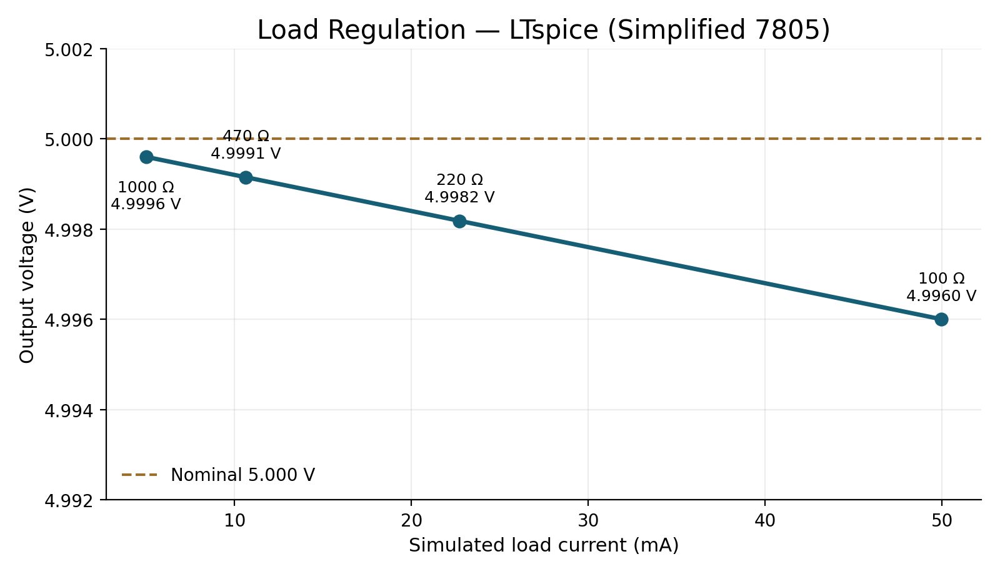
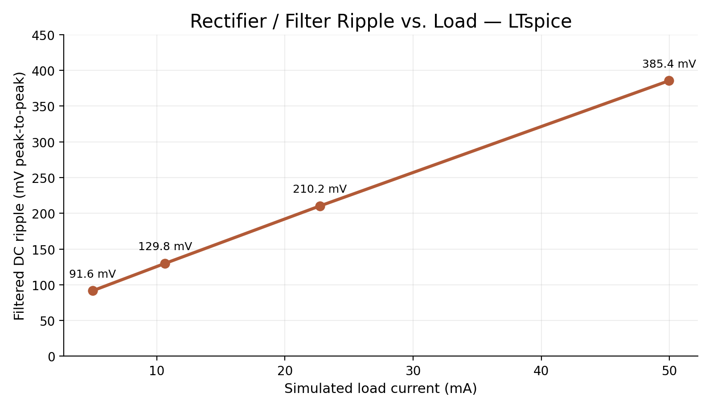
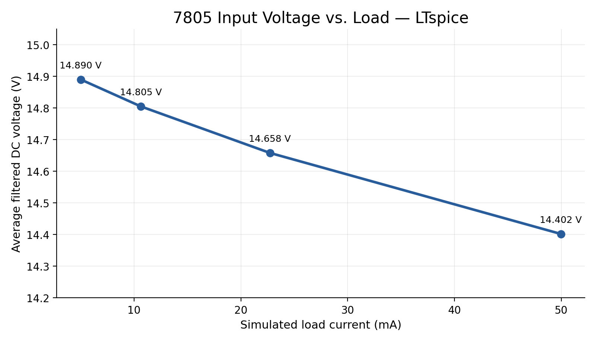

# Project 1 — LTspice Load-Sweep Results

**Circuit:** isolated nominal 12 V RMS AC → four-diode full-wave rectifier → 1,000 µF / 35 V filter → 7805 linear regulator → resistive load. The circuit also uses a 4.7 kΩ bleeder, a 0.33 µF input bypass and a 0.1 µF output bypass capacitor.

**Source:** User-provided LTspice 24.1.10 SPICE Error Log, October 28, 2026. **Steady-state measurement window:** 0.200–0.250 s. **Regulator model:** LM7805_EDU, a simplified teaching model, not a manufacturer-validated behavioral model.

## Load sweep

| Load (Ω) | Load current (mA) | VRAW avg (V) | VOUT avg (V) | VRAW ripple (mV pp) |
|---:|---:|---:|---:|---:|
| 1000 | 5.000 | 14.8901 | 4.9996 | 91.6 |
| 470 | 10.636 | 14.8049 | 4.9991 | 129.8 |
| 220 | 22.719 | 14.6581 | 4.9982 | 210.2 |
| 100 | 49.960 | 14.4021 | 4.9960 | 385.4 |

The modeled output changed by **3.597 mV** between the 1 kΩ and 100 Ω load endpoints, or **0.072% of nominal 5 V**. This is a change between tested loads, not a formal no-load-to-full-load data-sheet regulation specification.

Input-filter ripple rose from **91.6 mV pp** (1 kΩ) to **385.4 mV pp** (100 Ω), consistent with greater capacitor discharge at higher loads. The filtered DC average also fell as the load increased.

## Bench measurements (reported)

| Bench test | Reported observation | Caveat |
|---|---:|---|
| AC input | 11.9 V RMS | Isolated low-voltage source |
| Unfiltered bridge output | 10.0 V DC average | DMM DC mode |
| Filtered bridge voltage | 15.2 V DC | Early measurement |
| 7805 DC input | 15.3 V DC | Under reported load-testing conditions |
| 7805 output with 1 kΩ load | 4.99 V DC | Exact reported value |
| Oscilloscope filtered-DC ripple | Close to ~27 mV pp | Approximate report; exact measurement/load not logged |
| 7805 input current at 100 Ω | 55 mA | Reported confirmation of estimate |
| Output with 470 Ω and 220 Ω loads | Reported to agree with calculations | Exact DMM readings not logged |

**Do not substitute** simulation values for unrecorded bench measurements. The approximately 27 mV bench ripple and 91.6 mV simulated ripple at 1 kΩ are not a validated agreement; the loads, meter settings, and model's internal current requirements should be checked before drawing conclusions about the difference.

## Measured regulator-stage efficiency (100 Ω test)

Using the reported **15.3 V input**, **4.99 V output**, **55 mA input**, and **100 Ω output load**:

- Output current: 4.99 / 100 = **49.9 mA**
- Regulator DC input power: 15.3 × 0.055 = **0.8415 W**
- DC load output power: 4.99² / 100 = **0.2490 W**
- Regulator-stage efficiency: Pout / Pin = **29.59%**
- Difference between DC input and DC output power: **0.5925 W** (primarily regulator heat)

This is **7805 stage efficiency only**, not the AC-source-to-DC-load efficiency of the full supply. Total system efficiency would require a proper AC input real-power measurement and accounting for rectifier/bleeder losses.

## Model and validation limitations

- The LM7805_EDU model is simplified. Predicted microvolt-scale `VOUT_RIPPLE` is not a trustworthy prediction of measured regulator output noise or ripple.
- No thermal shutdown, safe operating area, regulator component tolerance or detailed line/load transient behavior has been validated.
- A measured ripple near 27 mV does not establish exact agreement with simulated 91.6 mV at 1 kΩ, especially when physical load/current, capacitor characteristics, and oscilloscope settings were not precisely logged.
- At 100 Ω / ~5 V, the physical load resistor dissipates about 0.25 W; a 1 W-rated resistor provides margin for sustained testing. The 7805 dissipates approximately 0.59 W at the documented 100 Ω operating point and should be checked for thermal rise and heatsinking requirements.

## Suggested conclusion

A low-voltage full-wave rectifier, reservoir capacitor, and 7805 produced a measured 4.99 V regulated output from an approximately 11.9 V RMS isolated AC source. LTspice stepped-load simulations produced 4.9960–4.9996 V outputs between 100 Ω and 1 kΩ using a simplified regulator model, while rectifier-filter ripple increased under load. A 100 Ω bench load produced approximately 29.6% DC regulator-stage efficiency, illustrating the heat-loss tradeoff of linear regulation. Future work could compare against a buck switching stage and obtain full AC-to-DC real-power efficiency.
